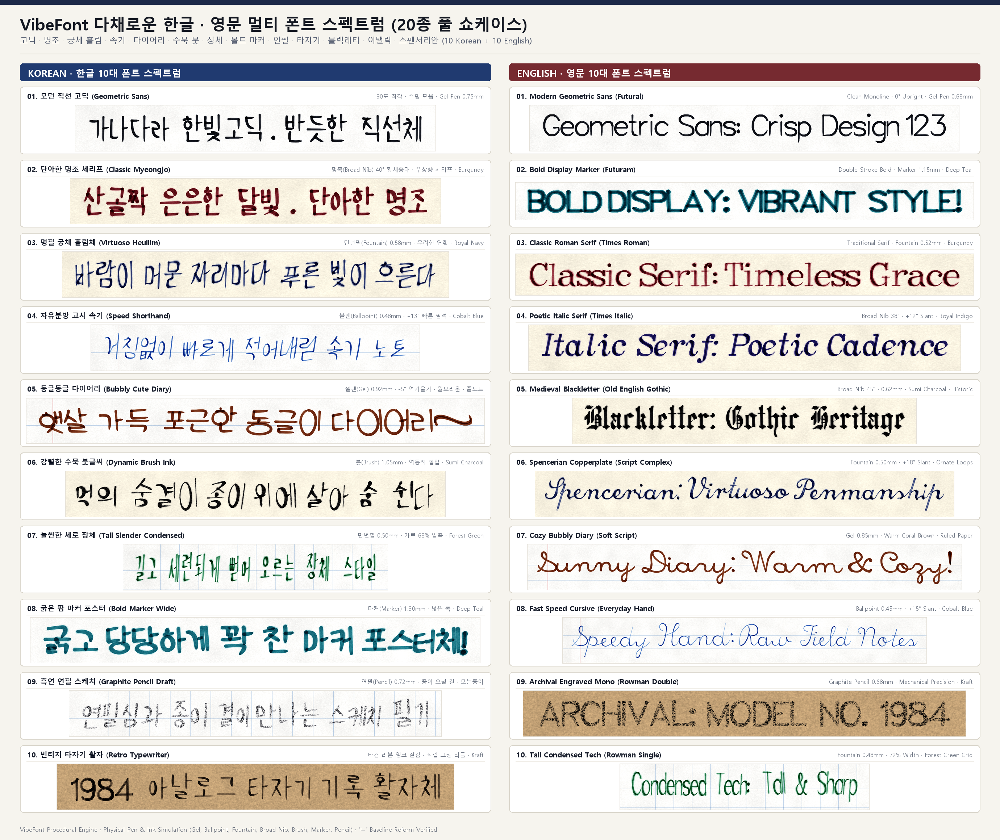
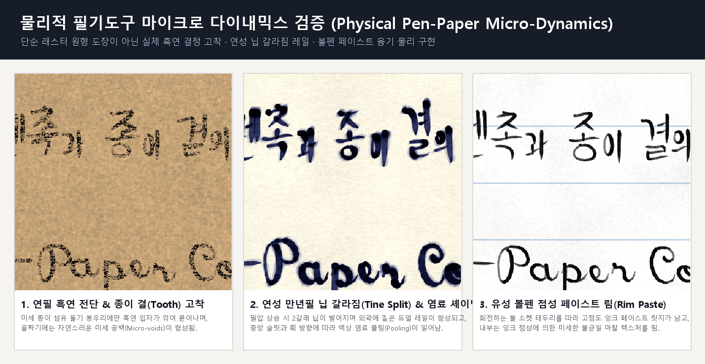
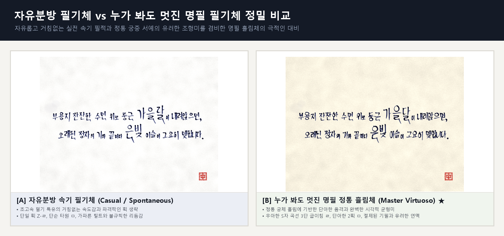
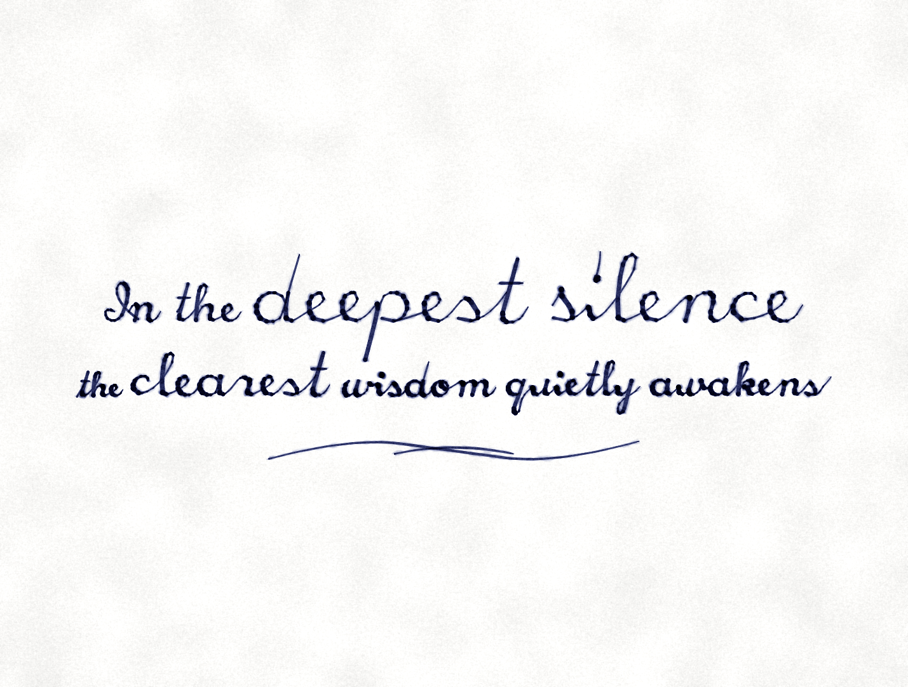

# VibeFont ✒️✨

> **Text + Vibe Prompt ➔ Diverse Fonts & Physically Grounded Handwriting**  
> 고정된 단일 폰트나 디지털 스탬프를 넘어, **한글·영문 16종 이상의 다채로운 서체 아키타입(고딕·명조·궁체 흘림·속기·다이어리·타자기·블랙레터·스펜서리안 등)**과 **아날로그 필기구의 물리적 접촉 흔적(만년필 닙 갈라짐·볼펜 림 페이스트·연필 흑연 입자 고착)**을 결합한 차세대 멀티 폰트 및 필기 합성 엔진입니다.

[](LICENSE)
[](pyproject.toml)
[](tests/)
[](docs/MASTER_PLAN.md)

---

## 🎨 20-Font Multi-Style Spectrum (한글 10종 + 영문 10종)

하나의 정형화된 필기체에 머물지 않고, 기하학적 직선 고딕부터 평촉(Broad Nib) 기반 명조 세리프, 전통 궁체 흘림, 빠른 속기, 귀여운 다이어리, 수묵 붓글씨, 중세 블랙레터, 스펜서리안, 레트로 타자기까지 **자연어 프롬프트 또는 파라미터로 자유롭게 생성**합니다.



### 지원 서체 아키타입 (`StyleSpec.archetype`)

| 계열 | 아키타입 키 | 한글 / 영문 특성 및 조형 구조 |
| :--- | :--- | :--- |
| **모던 직선 고딕** | `geometric_sans` | 90도 직각 코너, 수평 모음/받침('ㄴ' 처짐 제거), 군더더기 없는 산세리프 (`futural`) |
| **단아한 명조/바탕** | `classic_myeongjo` | 횡세종태(가로 가늘고 세로 굵음), 우상향 세리프 발끝 삐침, 로만 세리프 (`timesr`) |
| **명필 궁체 흘림** | `master_heullim` | 우아한 S자 3단 굽이침 'ㄹ', 유선형 'ㅁ·ㅂ', 스펜서리안/카퍼플레이트 (`scriptc`) |
| **자유분방 고시 속기** | `gosi` | +13° 빠른 기울기, 1획 지그재그 Z-'ㄹ'·타원 'ㅁ', 신속한 필기 리가처 (`cursive`) |
| **동글동글 다이어리** | `rounded_diary` | 확장된 개방형 원형 'ㅇ·ㅎ', 부드러운 코너 라운드, 친근한 손글씨 (`scripts`) |
| **정갈한 정자체** | `classic_jeongja` | 기울기 없는 90도 직교 분리획(2획 ㄱ·ㄴ, 3획 ㅁ, 4획 ㅂ), 제도 로만 (`rowmans`) |
| **수묵 붓/강조 헤드** | `bold_head` | 웅장한 초성·콤팩트한 받침 대비, 볼드 세리프 (`timesrb`) & 붓 필압 모듈레이션 |
| **굵은 팝 마커체** | `bold_marker` | 1.3mm 마커 닙, 더블 스트로크 볼드 디스플레이 (`futuram`), 강한 포스터 존재감 |
| **중세 블랙레터** | `blackletter` | 45° 평촉 닙 각도, 고딕 올드 잉글리시/프락투어 조형 (`gothiceng`) |
| **이탤릭 세리프** | `italic_serif` | 유려한 12° 이탤릭 슬랜트, 평촉 굵기 대비 (`timesi`) |
| **빈티지 타자기** | `retro_typewriter` | 균일한 타자 리듬, 모노스페이스 타건 텍스처, 제도 더블 스트로크 (`rowmand`) |
| **장체 / 평체 / 스케치** | `tall_slender`, `wide_round`, `upward_flow` | 68% 슬림 장체, 125% 통통한 평체, 우상향 자유 스케치 변형 |

---

## 🔬 물리 기반 펜·종이 접촉 마이크로 셰이더 (`fluid.py`, `pens.py`, `raster.py`)

단순히 원형 브러시를 찍는 컴퓨터 래스터 방식을 탈피해, **7종 필기구(`ballpoint`, `gel`, `fountain`, `pencil`, `marker`, `brush`, `broad_nib`)와 5종 종이(`plain`, `ivory`, `ruled`, `grid`, `kraft`)의 물리적 상호작용**을 시뮬레이션합니다.



* **연필 (Pencil Graphite Shear):** 종이 섬유 돌기(Paper Tooth Peaks)에만 흑연 결정이 깎여 묻어나고, 골짜기에는 자연스러운 미세 공백(Micro-voids)이 남습니다.
* **만년필 (Fountain Pen Tine Split & Pooling):** 필압 상승 시 두 갈래 닙이 벌어지며 외곽 듀얼 레일이 형성되고, 저속 커브 구간의 머무름 시간(Dwell-Time)에 따라 잉크 고임(Shading)과 셀룰로오스 섬유 지향 번짐, 젖은 획 교차 번짐(Wet-on-Wet Bleed)이 발생합니다.
* **유성 볼펜 (Ballpoint Rim Paste & Indentation):** 볼 소켓 테두리에 뭉친 고점도 잉크 릿지(Rim Paste), 회전 주기 기반 미세 스킵, 필압에 의한 미세 종이 눌림(Micro-relief)을 재현합니다.

---

## ✒️ 자유분방 속기 vs 명필 정통 캘리그라피

문맥적 리가처 엔진([`ligature.py`](src/vibefont/generate/ligature.py))과 생체역학적 관성 삐침([`calligraphy.py`](src/vibefont/generate/calligraphy.py))이 결합되어 거침없는 실전 속기체부터 서양 스펜서리안·조선 궁체 캘리그라피까지 폭넓게 표현합니다.

| 한글: 자유분방 속기체 vs 명필 정통 흘림체 | 영문: 스펜서리안 만년필 캘리그라피 |
| :---: | :---: |
|  |  |

---

## 🚀 Quickstart

### 1. 설치 (Installation)

```bash
git clone https://github.com/eljja/VibeFont.git
cd VibeFont
python -m venv .venv
# Windows (PowerShell): .venv\Scripts\Activate.ps1
# Linux/macOS: source .venv/bin/activate
pip install -e ".[placeholder,dev]"
```

### 2. CLI 사용법 (`vibefont`)

```bash
# 프롬프트만으로 원하는 폰트·펜·종이 조합 생성
vibefont write "가나다라 한빛고딕" -p "깔끔하고 모던한 직선 고딕체 젤펜" -o gothic.png --seed 42
vibefont write "바람이 머문 자리마다 푸른 빛이 흐른다" -p "명필 흘림체 남색 만년필 미색" -o heullim.png
vibefont write "Blackletter Heritage" -p "중세 고딕 블랙레터 평촉" -o blackletter.png

# SVG 벡터 출력 / 웹 스튜디오 실행
vibefont write "1984 기록" -p "빈티지 타자기체 크라프트" -o archival.svg
vibefont serve --port 8080
```

### 3. Python API 사용 예시

```python
import numpy as np
from vibefont.vibe.interpreter import interpret
from vibefont.generate.procedural import ProceduralGenerator
from vibefont.document.pipeline import write_document
from vibefont.render.raster import render_page

spec = interpret("단아한 명조체 평촉 버건디 미색 종이")
spec.seed = 2026

gen = ProceduralGenerator()
pages = write_document("산골짝 은은한 달빛이 고요히 흐른다.", spec, gen, np.random.default_rng(spec.seed))
img = render_page(pages[0], spec, dpi=300)
img.save("myeongjo_sample.png")
```

### 4. 테스트 실행

```bash
pytest tests/ -q
```

---

## 📂 Repository Structure

```text
VibeFont/
├── docs/
│   ├── assets/                      # README 쇼케이스 고해상도 샘플 이미지
│   ├── MASTER_PLAN.md               # 듀얼 트랙 개발 마스터 플랜
│   ├── CALLIGRAPHY_REALISM.md       # 생체역학 캘리그라피 리얼리즘 설계서
│   ├── USER_GUIDE.md                # 사용자 가이드
│   └── reviews/                     # 아키텍처 리뷰
├── src/vibefont/
│   ├── vibe/                        # VibeSpec 계약, 한국어/영어 프롬프트 렉시콘 & LLM 인터프리터
│   ├── generate/                    # 한글 자모 알로그래프, 리가처, 운동학(Kinematics), 캘리그라피, LMM 모델
│   ├── document/                    # 페이지 레이아웃, 줄바꿈, OU 드리프트(피로도·자간 흐름)
│   ├── render/                      # 물리 펜 팁, 잉크 유체 셰이더, 종이 질감, SVG/래스터 렌더러
│   ├── models/ & htr/ & data/       # 자기회귀 스트로크 모델, HTR CTC 정렬, 데이터셋 파이프라인
│   └── web/ & cli.py                # 로컬 인터랙티브 웹 스튜디오 & CLI
├── scripts/                         # 대량 쇼케이스 & 물리 펜 비교 렌더링 스크립트
├── tests/                           # 148개 단위/통합/회귀 테스트 스위트
└── pyproject.toml
```

---

## 📜 License

This project is licensed under the Apache License 2.0 - see the [LICENSE](LICENSE) file for details.
